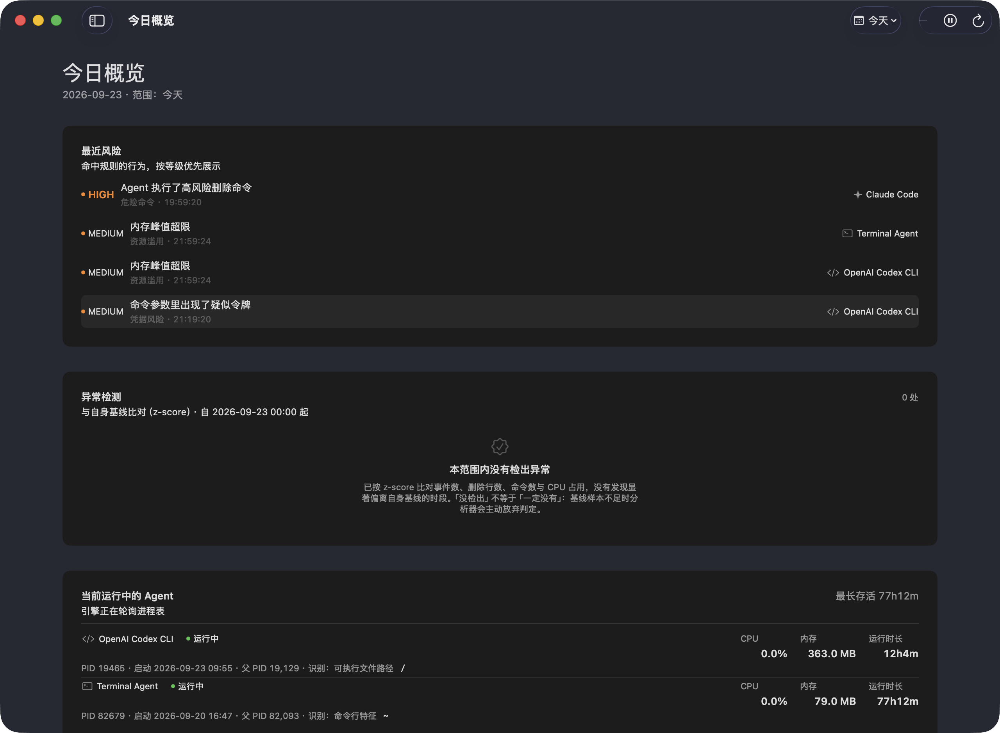
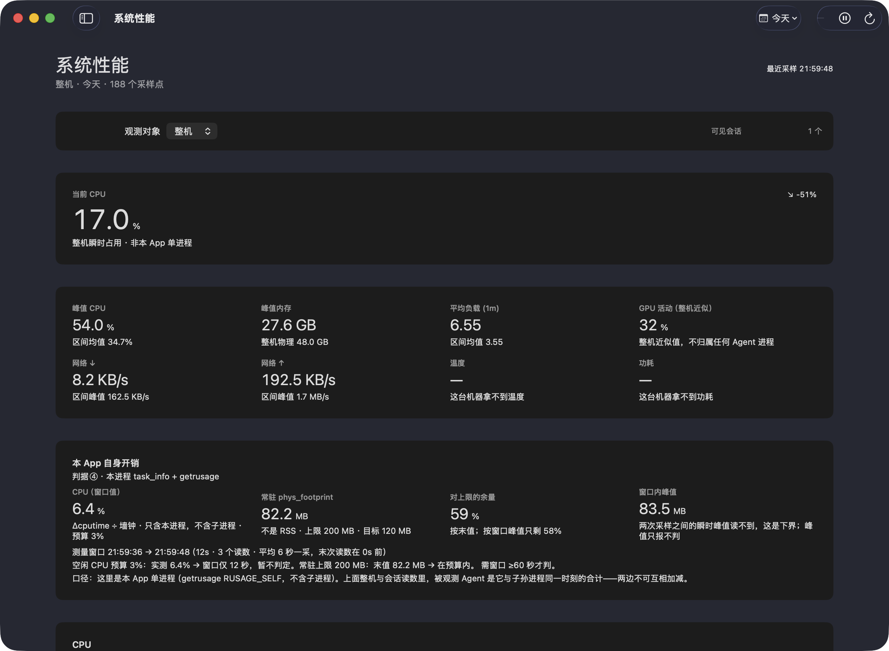

# AiX

**AI Agent 活动审计台**（本地运行的 macOS 应用）。

一款 **100% 本地运行、零上传** 的 macOS 原生应用：审计这台机器上的 AI Agent
（Codex / Claude Code / Cursor Agent 等）**到底干了什么**——它们执行过的操作、
改动过的文件与 diff、跑过的终端命令、消耗的资源、触发过的风险动作。

观测结果只写进本机一个 SQLite 文件；删掉那个目录就等于删掉一切。
代码里**不存在任何网络调用点**，这一点下面给出可重跑的验证命令。

> **先读这一段。** 本仓库处于 **0.x 阶段**，八个能力模块的完成度**不均匀**：
> ④ 终端命令审计与 ⑤ 系统性能监控是「**部分**」，不是「达标」。
> 本页每一句能力描述都标了仓内证据；请连同 [已知限制](#已知限制) 一起读，
> 把那两格当成「按设计只能做到这个程度」，而不是「再调一调就好」。

---

## 界面

以下是**真实产物截图**，不是设计稿。拍摄方式（可复算，一步都不藏）：`Packaging/make-app.sh` 产出 ad-hoc 签名包
→ `AIOBS_FIXTURE_DIR=<目录> swift test --filter FixtureStoreSeeder` 造一份**夹具数据目录**
（历史读数全走合成路径 `/Users/dev/Projects/atlas-backend`，夹具自己会数一遍"有没有真家目录"）
→ 同一目录写一份 `settings.json`，把路径遮罩 `demoRedactedOutput` **打开**
→ `AIOBSERVATORY_SECTION=<板块名>` 直接选页（**不靠点击**）→
`Tools/UIProbe/capture-window.swift --pid <本次启动的 pid>` 只截自己那一个窗口。界面语言为简体中文。

> 这两张图出自源码 `949b4db` 构建的包（可执行文件 SHA-256 前缀 `e3fed0e9e6b01463`，
> 拍摄于 2026-09-23 21:59–22:00）。**截图与界面之间没有裁剪、遮瑕或替换任何数字。**

⚠️ **图里的数字请这样读，两半不一样**：
**历史那一半**（最近风险、异常检测、各类计数）来自上面那份**夹具库**，是合成数据——
要的是"这一页长什么样"，不是"这台机器干了什么"。
**当下那一半**（「当前运行中的 Agent」、性能页的 CPU/内存/负载/网络）是**这台开发机当时的真实观测**，
其中家目录已按产品自己的遮罩画成 `~`（第一版试拍时它默认关着，像素里就漏出过 `Users/one` 这一小段——
那是**开着遮罩才成立**的一句话）。本页对 CPU/内存的唯一说法见
[已知限制](#已知限制)第 5 条（结论是「不声称满足预算」）。
第二张图里那行「窗口仅 12 秒，暂不判定」不是文案装饰：判据④ 至今**未判定**，产品界面如实写着。

**Dashboard —— 概览页从上到下：最近风险 → 异常检测 → 当前运行中的 Agent → 时段累计 → 活动趋势**



**Performance —— 这一页同时展示了「能拿到什么」和「拿不到什么」**



第二张图值得停一下，它有三层"不装"：

1. `GPU 活动（整机近似）` 那格的副标题就是「**整机近似值，不归属任何 Agent 进程**」；
2. `温度` 与 `功耗` 两格显示的是「**这台机器拿不到温度 / 功耗**」而不是估算数，
   `网络 ↑/↓` 显示「等待首次采样」而不是画一条 0 线冒充有数据；
3. 瓷贴下方那段小字明写着：「本 App 自身的性能预算：空闲 CPU < 3%、常驻内存 < 200 MB。
   那是**本进程**的指标，与上面这些整机 / 会话读数**不是同一个对象**，
   故曲线与瓷贴都不按它画参考线；**界面当前没有测量自身开销，这里只给目标值**。」

第 3 条同时是本产品一个**如实标注的缺口**：这台工具能报出别人 18 小时 26 分的活跃时长，
却还没有把"我自己花了多少"做成一个读数——所以判据里的 3% / 200 MB 目前只能靠
外部工具（`footprint` / `vmmap` 的 `Physical footprint`）量，界面上看不到。

> 早期版本这张图里有两处标注是错的：`当前 CPU` 与 `峰值内存` 两格把**本 App 的预算**
> （3% / 200 MB）挂在了**整机读数**下面，CPU 曲线上还画了一条预算参考线压在整机曲线上——
> 按整机口径去读，`峰值内存 35.9 GB` 配「常驻预算 200 MB」会让人以为本工具超预算一百多倍。
> 该错配已修掉（整机视图下不再画预算线、不再显示预算 caption，改为上面第 3 条那段明写口径），
> 09-23 重拍的这两张里它仍是修好的样子：整机那一块只报整机，本 App 的开销单独一格并明写
> 「常驻 phys_footprint · 不是 RSS · 上限 200 MB · 目标 120 MB」。**我们宁可换图也不修图**：裁剪遮瑕属于造假，不属于修图。

> **为什么只有这两张。** 本工具的核心采集对象就是绝对路径与命令行参数，
> Timeline / Files / Commands / Sessions 这几页**会把某台真实机器的目录结构画在屏幕上**
> （例如 Commands 页会显示 `cd /Users/<某人的真实检出路径>/…`）。
> 拿那样的截图当门面，与这个产品存在的理由直接矛盾，所以不放。
> ⚠️ 这条理由现在**多了一条出口**：上面那套「夹具数据目录 + 遮罩打开」的配方，
> 拍出来的历史读数只含合成路径 `/Users/dev/…`，所以那几页**已经可以安全地拍**了——
> 本波只按 #12 的范围重拍了这两张，要扩页就照同一配方 `AIOBSERVATORY_SECTION=<板块名>` 再来一次。
> 想看那些页面：照下面 Quick start 自己构建，它显示的是**你自己的**机器。

---

## 八个能力模块

状态口径与需求验收标准一致：`达标` / `部分` / `未达标` / `待验`。
「依据」列全部可在本仓库内核对。

| # | 模块 | 状态 | 依据与边界 |
| --- | --- | --- | --- |
| ① | **Agent 自动识别**（名称 / 状态 / 启动时间 / 运行时长 / PID） | **达标** | 非特权 libproc 进程快照：`Sources/AIObservatoryPlatform/AgentDetection/LibprocProcessInspector.swift`；6 条识别策略按置信度首命中（`Sources/AIObservatoryPlatform/AgentDetection/DetectionStrategies.swift`），签名库 8 条（`Sources/AIObservatoryPlatform/AgentDetection/AgentSignatureDatabase.swift`：Claude Code / OpenAI Codex / Cursor / VS Code AI / Windsurf / Gemini CLI / Aider 共 7 个具名产品 + 1 条 `genericCLIAgent` 兜底；`AgentKind` 另有 `unknown`）。识别依据随记录一起保留（`AgentDetectionPipeline` 的 `detectedVia`），UI 能说明「凭什么认定它是 Agent」 |
| ② | **操作时间线**（逐条还原 Agent 做了什么） | **达标** | `events` 表 + `Sources/AIObservatoryUI/Timeline/`；行含时间 / Agent / 类型 / 路径 / 命令 / 结果。边界：资源消耗块在数值为 `.zero` 时整块隐藏 |
| ③ | **文件行为追踪 + Before/After Diff** | **达标** | FSEvents 监听 + 快照 + Myers diff：`Sources/AIObservatoryPlatform/FileSystem/`（`FSEventsWatcher`、`FileSnapshotter`、`DiffEngine`、`PathFilter`）。落 `file_changes` / `diffs` / `file_snapshots` 三张表；超 20,000 行或编辑距离 >4,000 时降级为整块摘要并置 `is_truncated`，不硬撑。**`.modified` 也是真 Before/After**：改前内容取「该路径上一次被观测到的内容」，留底在 `Sources/AIObservatoryEngine/FileTextBaselineCache.swift`（有界 LRU，命中即前移、超容量逐出最久未用；被逐出时该次如实回落成「首次观测」而不是假装还有历史）。每次对比都带溯源字段 `FileDiff.baselineSource`（`lastObserved` / `unavailableFirstSighting` / `notApplicable`）与 `baselineCapturedAt`；SQLite 侧 `PRAGMA user_version` 升到 **4**（`diff-baseline-provenance` 迁移），SwiftData 后端等价。**为什么只能靠留底、不能拿 `git show HEAD:path` 充当前版本**：FSEvents 是**变更后**通知，旧字节已被覆盖；而 git 里那个版本是「相对最近一次提交」，可能差着几十次编辑——把它标成 Before/After 只是换一种形状撒谎。**隐私开关（#15）**：`storeDiffPlaintext` 关掉后 diff 正文不入库，只留行增删与指纹 |
| ④ | **Terminal 命令审计**（命令 / 结果 / 耗时） | **部分** | 两条来源：**(a) 轮询推断** `CommandInferenceEngine`（沿父链找最近的 Agent pid）——对 30–50 ms 的短命命令**实测捕获率约 1–2%**，且轮询**永远拿不到退出码**（`outcome` 恒为 `.running`）；**(b) shell hook 精确来源** `Tools/AgentHooks/`——命令文本、退出码、起止时间来自当事进程本身，但**默认不生效，必须你自己写进 Agent 的 hooks 配置**。**因此本模块不得被描述为「完整记录所有命令」**，未装 hook 时它记录的是「采样窗口内恰好在跑的长命令」。重叠时以 hook 为准（`CompositeCommandAuditing`） |
| ⑤ | **系统性能监控 + 会话级性能时间线** | **部分** | 已采集：整机 CPU / 内存 / 磁盘 IO / load（`HostMetricsSampler`）、**网络速率**（`NetworkCounters`，`getifaddrs` 差分累计字节计数器）、**GPU 活动**（`GPUActivityReader`，IOKit `IOAccelerator`）。**硬边界：网络与 GPU 只有整机口径**——macOS 没有公开的非 root 按进程 API，所以这两个数包含 Chrome / WindowServer 等一切本机活动，**不能归因到某个 Agent**。会话级 `perf_samples` 的 `gpu_percent` 与网络字段至今恒 NULL / 0，界面也不在会话视图里画它们（`PerformanceSeriesPoint` 的会话初始化写死 `nil`，有测试钉住）。**温度与功耗不是本工具的能力**，见下节。**会话级开销是「Agent ∪ 其子孙进程在同一时刻之和」**：
像 Claude Code / Codex 这类 Agent 的活全在子 shell / node 进程里、父进程几乎闲置，
只报父进程会系统性低报。峰值的口径是**先按同一 tick 求和、再对行取 max**——
反过来把各进程峰值相加会拼出一个从未同时发生过的数（`ObservatoryEngine.ingestPerformance`，测试钉住） |
| ⑥ | **Session 管理**（搜索 / 筛选 / 导出） | **达标** | 搜索 + 多维筛选 + 分页；导出 JSON / CSV / Markdown 三种，从 Sessions 页可达（`SessionsView` → `ObservatoryExporting` → `ExportCoordinator`）。两层真实防护：`ExportRedactor`（掩掉 11 类**凭据形态**，默认开）与 `ExportWriter.validate`（`allowedRoots` 白名单 + 符号链接解析 + `forbiddenPrefixes`）。**但路径、用户名、argv 里的文件名不在脱敏范围内**——它们是审计对象，导出必然带着走 |
| ⑦ | **项目级 AI 活动地图** | **达标** | `Sources/AIObservatoryInsights/`：多因子热度评分驱动排序（`HotFileRankingTests` 钉住「今天 8 次 > 40 天前 40 次」）、z-score 异常检测、代码增长估计。边界：`efficiencyScore` 不是真指标，界面已如实显示为「文件数/活跃秒」 |
| ⑧ | **安全风险检测**（LOW / MED / HIGH + 需确认） | **达标** | 单一规则库 **33 条** `risk.*`（`grep -rhoE '"risk\.[a-z0-9._-]+"' Sources/AIObservatoryRiskRules/ \| sort -u \| wc -l` → 33），4 个规则族；真机由**真实执行的命令**产出过 `risk_events`（`chmod -R 777` → HIGH），确认按钮落库。**边界：这是告警不是阻断**——没有任何代码路径能阻止一条命令运行；匹配是子串/正则，`r\m -rf`、变量拼接、别名一律不命中；依赖命令事实的规则在纯采样下命中率仍然很低（同 ④） |

**架构与模块清单的完整口径**见 `Documentation/README.md` 第 1 节（全仓完成度表，含每个 target 的真实接线状态）。

---

## Quick start

前置条件：**macOS 26+ / Apple Silicon / Swift 6.2 工具链**（`Package.swift` 声明
`tools-version: 6.2`、`.macOS("26.0")`、`swiftLanguageModes: [.v6]`）。**零外部依赖**
（`grep -c '\.package(url:' Package.swift` → `0`），不需要 CocoaPods / SPM 拉包。

```bash
git clone <本仓库地址>        # 见下方说明
cd ai-observatory

swift build --disable-sandbox          # 调试构建
swift test  --disable-sandbox          # 全量测试
Packaging/make-app.sh                  # 唯一打包入口 → dist/AIObservatory.app

open dist/AIObservatory.app
```

> 本仓库**尚未公开**（`git remote -v` 输出为空）。上面的 clone 行是给公开后的读者写的；
> 现在拿到源码的方式是自行下载快照，或等维护者公布地址。
> 因此这里也**不放** CI 状态徽章或许可证徽章链接——那会指向不存在的页面。

**关于 `--disable-sandbox`（本地必需、公开 CI 上禁止）**

- **本地为什么必需**：常见开发/自动化环境本身已经跑在 sandbox 里，SwiftPM 再嵌套一层
  `sandbox-exec` 会直接失败并报 `sandbox_apply: Operation not permitted`。这个 flag 是
  **环境补丁，不是本包的构建要求**。在你自己没套沙箱的机器上，直接 `xcrun swift build`
  才是更接近真实用户的路径。
- **CI 上为什么禁止**：托管 runner 没有外层 sandbox，加它既多余，又会永久掩盖
  「SwiftPM 沙箱兼容性回归」这类真实问题。`.github/workflows/ci.yml` 有一步专门检查
  构建/测试命令里不得重新出现该 flag。
- **打包怎么兼顾两者**：`Packaging/make-app.sh` 把它参数化为 `AIX_SPM_SANDBOX_FLAG`——
  未设置时保留本地默认（带 flag），CI 上显式传空串（`AIX_SPM_SANDBOX_FLAG="" Packaging/make-app.sh`）
  即还原 SwiftPM 默认行为。

首次打开 ad-hoc 签名的 `.app` 会被 Gatekeeper 拦（「无法验证开发者」），
绕过办法与原因见 `Documentation/INSTALL.md`；签名与分发的信任边界见 `Documentation/SECURITY.md`。

**跑起来之后，数据在哪**：打包运行 = `~/Library/Application Support/com.aix.aiobservatory/observatory.sqlite`
（含 `-wal` / `-shm` 边车）。四条解析规则的优先级由 `Sources/AIObservatoryApp/DataLocation.swift` 决定：
`$AIOBSERVATORY_DATA_DIR` → 打包运行 → 仓库内 `observatory-data/` → **内存库**（目录建不出来时，
一个字节都不落盘，不崩、不偷偷写到别处）。开发验证请显式设 `AIOBSERVATORY_DATA_DIR` 指到仓库内，
验完删掉——那里面是你真实的进程清单。

---

## 隐私：采了什么，以及**还没做**什么

这一节刻意写成两半。**「还没做」那半是这个产品可信度的来源，不是负担。**

### 零上传是可核对的，不是口号

```bash
# 网络 API 命中数（预期 0）
grep -rnE 'URLSession|NWConnection|NWListener|NWParameters|socket\(|CFNetwork|getaddrinfo|MCSession|NetService|import Network' Sources/ | wc -l
# 更强的形式：Sources/ 的 import 全集可枚举——有 IOKit / Darwin，但没有 Network / CFNetwork
grep -rhoE '^import [A-Za-z]+' Sources/ | sort -u
```

无许可服务器、无激活、无账号、无崩溃上报、无更新检查。断网后功能完全一致
（它**读**内核网卡计数器，但**不发起**任何连接）。完整论证与二进制层自查方法见
`Documentation/PRIVACY.md` 第 2 节。

### 正在采集并落盘的（敏感度高）

| 采什么 | 为什么敏感 |
| --- | --- |
| 每个进程的**可执行文件完整路径**、**cwd**、**argv** | 含用户名与目录结构；argv 是**最高敏感列**——参数里常有文件路径、仓库地址、内联 token |
| 被改动文件的**完整路径**、内容**哈希**、行数、字节数 | 哈希不可反推内容，但能判定内容是否变过 |
| **diff 行文本**（`diffs.lines_json`） | **这就是文件明文片段本身**。本工具**不**声称「不记录文件内容」 |
| 整机 CPU / 内存 / 磁盘 / load / **网卡收发字节** / **GPU 利用率** | 聚合量，敏感度低，且不归因到进程 |

**明确不采集的**（这些常被误报成泄漏）：环境变量**根本不读**（`KERN_PROCARGS2` 的读取受
`argc` 约束，遍历不到 envp 区，所以「env 白名单过滤」是**尚未需要**的能力而非已实现功能）；
文件 mtime / ctime 不落盘；不读 `~/.claude`、`~/.codex`、shell history；不打开任何 socket。

### 还没做的防护（**别把这些当成已有功能**）

| 缺口 | 事实 | 怎么核 |
| --- | --- | --- |
| **diff 明文无法关闭** | `AGENTS.md` 第 7 节要求文件内容明文「可关闭」，但**这个开关不存在** | `grep -rniE 'enableDiff\|captureDiff' Sources/ Tests/` → **0 命中** |
| **入库层零脱敏** | 能**少采**（`PathFilter` 按路径不监听），**不能采了再遮**。diff 行、argv、路径原样入库 | `Documentation/PRIVACY.md` §7 |
| **数据库静态加密** | 明文 SQLite，仅受 macOS 文件权限（当前用户可读）保护，**没实现任何加密** | 同上 |
| **没有「删除我的数据」按钮** | 清空是手工 `rm`，且必须先退出 App（运行中删库会让 WAL 边车与主库不一致）；保留期清理走 `DELETE` 不做 `VACUUM`，文件不会缩小 | `Documentation/PRIVACY.md` §3 |
| **统一日志残留不受控** | OSLog（subsystem `com.aix.aiobservatory`）的保留时长由 macOS 决定 ⇒ 本工具**无法承诺零残留** | 同上 §1 |
| **导出后失控** | 导出物是高敏文件；`ExportRedactor` 只掩凭据形态，**路径 / 用户名 / argv 文件名照写**。把导出目标选在同步盘或公开仓库，等价于自愿公开你的机器行为画像 | 同上 §5.4 |

### 「它是 Agent」和「这条命令危险」都是**推断**

读到的数据能证明「某 pid 在某时刻存在、以什么参数启动」，
**不能**证明「这条命令是这个 Agent 决定的」（那是沿父链归因），
更**不能**证明命令是否成功。这些结论**不是密码学证据**：没有签名、没有审计链、
数据库被本机任意进程改写后无从分辨。

> **本工具的输出可用于自我审计与事后回溯，不可作为对第三方追责的司法级证据。**

---

## 已知限制

这一节是本页最需要被认真读的部分。前三条是**机制性**的，不会因为多花两天就消失。

1. **④ 命令审计：轮询天生漏采，退出码天生拿不到。**
   两次扫描之间启动并退出的进程**永不可见**；3 秒间隔对 30–50 ms 短命命令的
   捕获率**实测约 1–2%**。轮询模式下 `exit_code` **恒空**——
   该 Agent 消失后，它名下未闭合的命令会被收敛成「**随进程结束（退出码未知）**」，
   而不是永远挂着「运行中」；此时**耗时是一个上界**
   （起点 = 捕获时刻，终点 = 该进程最后一次可见，最坏高估一个扫描周期），
   界面与导出都不许把它显示成精确值。
   精确来源（命令 + 退出码 + 真实耗时）需要**你自己安装** `Tools/AgentHooks/` 里的 shell hook，
   **默认关闭、不会自动生效**。
   *EndpointSecurity 事件流能补上这个洞，但它需要 Apple 特批的
   `com.apple.developer.endpoint-security.client` entitlement，个人 / ad-hoc 项目基本拿不到；
   本仓库只有能力探测器，**不订阅任何事件**，而且把那个 entitlement 签进 ad-hoc 包会让
   App 启动即被 AMFI SIGKILL（实测退出码 137）。*

2. **⑤ GPU 与网络只有整机口径，做不到按 Agent 归因。**
   macOS 没有公开的非 root「按进程网络字节 / GPU 占用」API。
   界面上这两项只出现在「整机」口径（GPU 瓷贴标题就是「GPU 活动（整机近似）」），
   会话视图与 Agent 归因图表里**不画**它们。

3. **温度与功耗在 Apple Silicon 上拿不到值——这不是待办，是平台天花板。**
   `ThermalPowerReader` 遍历 AppleSMC 候选温度 key，M 系列上这些 key 多数不存在 ⇒ 返回 `nil`；
   功耗则**固定 `nil`**，因为 macOS 没有公开的整机功耗读取 API（`IOPM` 只给电池信息）。
   实现里的注释写着「严禁伪造：任何一项拿不到就返回 nil，绝不以估算值填充」，
   界面对应地显示「这台机器拿不到温度 / 功耗」。**所以温度/功耗不在上面的能力表里，
   任何文档也不该把它们列为能力。**

4. **并列时间戳的行序，两个后端不保证一致。**
   SQLite 后端按 TEXT 的 `COLLATE BINARY` 字节序做 `id DESC` tie-break，
   而 SwiftData 对字符串列的排序**不是** BINARY 字节序。语义（选哪些行、`totalCount`、
   分页游标）两侧一致，但**时间戳完全相同的并列行，行序可能不同** ⇒ 并列行较多时
   导出报告与「两库逐行对账」的顺序会不一致（内容与条数不受影响）。
   该边界已被显式接受并记录，见 `Documentation/README.md` 第 1 节 SwiftData 那一行与
   `Tests/AIObservatorySwiftDataStoreTests/SwiftDataBackendDifferentialTests.swift` 套件头注释。

5. **性能预算：CPU 达标，内存超限，且仓库里没有自动化性能门禁。**
   预算是空闲 CPU < 1%（上限 3%）、常驻内存 < 120 MB（上限 200 MB）。
   真机整轮 CPU **0.0–0.4% 达标**，RSS 一帧 180 MB、另一帧 209–211 MB（**超上限**）。
   另外**度量口径容易用错**：`ps -o %cpu` 是**衰减平均**，同一进程会在 0.0–17.1% 之间乱跳，
   拿它判空闲 CPU 会系统性误判；正确算法是「Δ(累计 cputime) / Δ(墙钟)」，窗口 ≥ 60 秒，
   且必须在没有其它编译任务的静默机器上测。
   ⇒ 本页**不声称**满足性能预算。

6. **风险告警的实战样本仍然很薄。** 33 条规则「已加载」有证据、「真机命中过一条」有证据，
   但**这不等于具备可用的告警能力**：规则依赖命令事实，而命令事实受第 1 条限制。

7. **零图标、零品牌资源。** 仓库当前没有任何 `.icns` / 图标资源，
   `Packaging/make-app.sh` 因此在没有真图标时**不写** `CFBundleIconFile`
   （指向不存在的文件比不写更糟）。本页也没有 logo——不放占位图。

---

## 文档

| 文件 | 讲什么 |
| --- | --- |
| [`Documentation/README.md`](Documentation/README.md) | **全仓真实完成度表**（每个 target 的接线状态 + 代码位置）、架构分层、构建、路线图 |
| [`Documentation/PRIVACY.md`](Documentation/PRIVACY.md) | 数据落在哪、零上传的代码依据、如何清空、离线运行、采集边界与残留风险、**尚未实现**清单 |
| [`Documentation/SECURITY.md`](Documentation/SECURITY.md) | 信任模型（能证明什么/不能证明什么）、两条采集路径对比、签名与分发信任、无沙箱的取舍、威胁模型清单 |
| [`SECURITY.md`](SECURITY.md)（仓库根） | **漏洞与隐私顾虑怎么报告**：渠道、该附什么、**绝不要附什么** |
| [`Documentation/INSTALL.md`](Documentation/INSTALL.md) | 从源码安装、ad-hoc 签名包的打开方式、前置条件、卸载、故障排查 |
| [`Documentation/PRIVACY-EVIDENCE.md`](Documentation/PRIVACY-EVIDENCE.md) | `Resources/PrivacyInfo.xcprivacy` 逐条 required-reason 证据 |
| [`Documentation/OPEN-SOURCE.md`](Documentation/OPEN-SOURCE.md) | 许可证选型论证（MIT vs Apache-2.0）、公开前清单与未验证项 |
| [`Packaging/ENTITLEMENTS-NOTES.md`](Packaging/ENTITLEMENTS-NOTES.md) | entitlements 完整取舍论证，含「ES 档签进 ad-hoc 包会 SIGKILL」的实测 |
| [`Tools/AgentHooks/README.md`](Tools/AgentHooks/README.md) | 可选的精确命令来源：装之前必读的隐私说明与安装步骤 |
| [`CONTRIBUTING.md`](CONTRIBUTING.md) · [`AGENTS.md`](AGENTS.md) | 贡献流程 / 仓库铁律（授权边界、工作树纪律、文件所有权、性能预算） |

## 参与贡献

先看 [`CONTRIBUTING.md`](CONTRIBUTING.md)（含「提 PR 前自查」四条命令），
行为准则见 [`CODE_OF_CONDUCT.md`](CODE_OF_CONDUCT.md)。
本项目的 issue 模板有两个是刻意写麻烦的：`.github/ISSUE_TEMPLATE/privacy_report.yml` 让你在**不暴露自己机器足迹**
的前提下报告隐私顾虑。

## 许可证

Apache-2.0，见 [`LICENSE`](LICENSE)。版权主体为 `AiX Project Authors`，
许可证文本里不含任何个人邮箱。

按现状（AS-IS）提供，**无担保、无支持承诺、无响应时限**。
这不是形式话术：本项目当前没有公开邮箱、没有 disclosure 流程、没有 moderation 团队，
所以页面上不假装存在这些。
